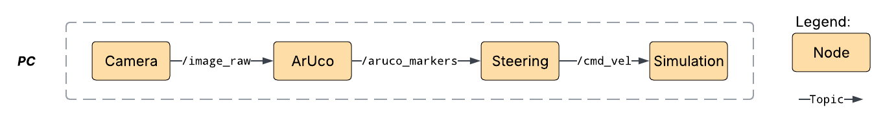
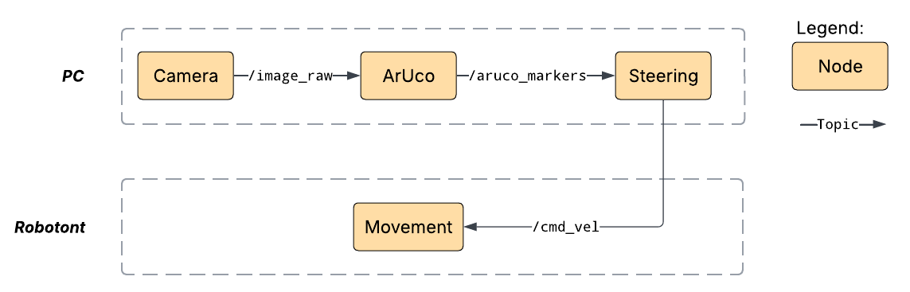

# demo_ar_steering
This demo enables to steer Robotont using **ArUco** markers.

## Prerequisites
> **TODO:** Camera setup needed?

## Launching the demo
The demo has two configurations. You can either run a simulation locally in `rviz`, the ROS 2 visualization tool, or run it on a physical robot. Two launch files handle all the necessary nodes and configuration. First, build the project and source the workspace:
```bash
colcon build
source install/setup.bash
```

Both launch files declare the following parameters, which you can override from the command line:

| Parameter | Default | Description |
|---|---|---|
| `marker_id` | `0` | ID of the AR marker to detect |
| `cmd_vel_topic` | `/cmd_vel` | Topic the velocity commands are published to |

Run a local simulation:
```bash
ros2 launch demo_ar_steering sim.launch.py marker_id:=<id> topic_:=<topic>
```

To run the demo on a physical robot, the robot and the PC must be on the same network:
```bash
ros2 launch demo_ar_steering irl.launch.py marker_id:=<id> topic_:=<topic>
```

## Architecture
The diagrams below show how the nodes and topics connect in each configuration.

The simulation runs locally on one machine, so every node communicates on the same computer:  


On the physical setup, the camera and the steering logic run on the PC and the velocity commands travel over the network to the robot:  

